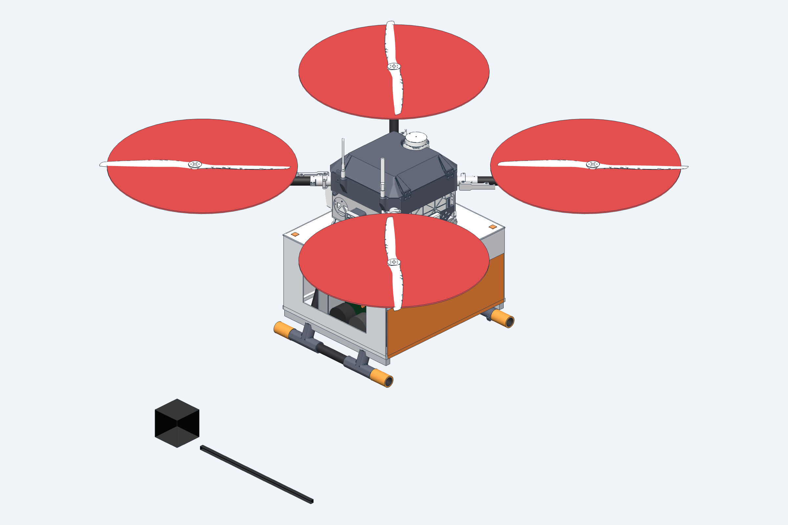
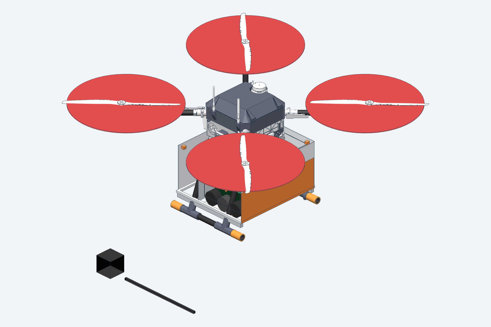
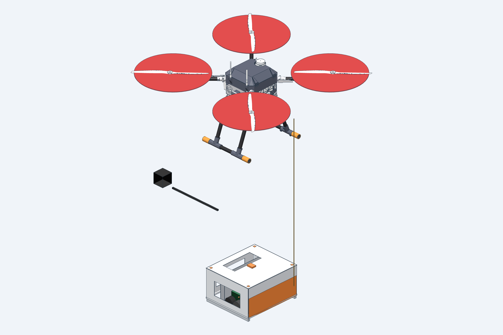
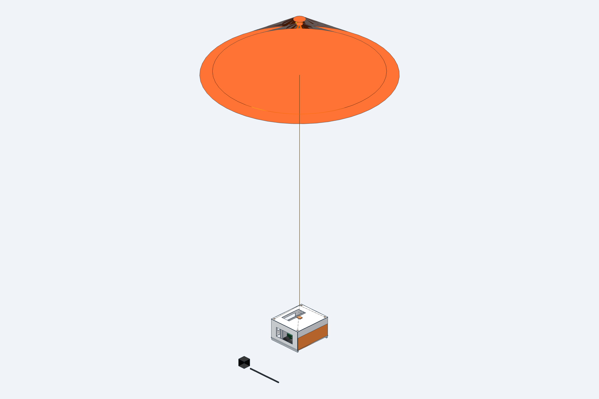
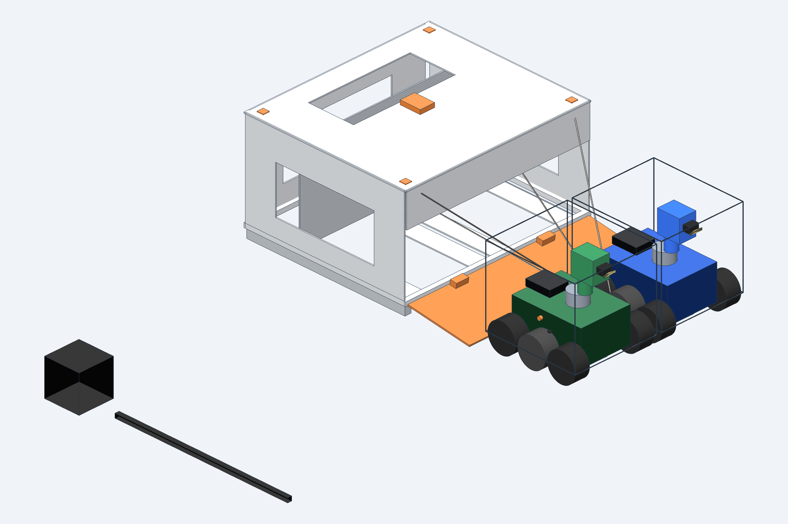
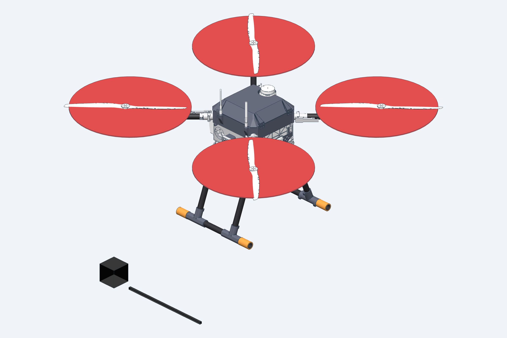

# Mothership ground-robot concept

One [Project Quiver](https://github.com/Arrow-air/project-quiver) carrier. One pod. Two [Waveshare UGV Rover](https://www.waveshare.com/wiki/UGV_Rover_PI_ROS2) robots. One shared parachute.

This is a packaging study. It is not flight hardware.

[**Play the 27-second demo**](quiver-pod-drop/render/quiver-drop.mp4)

[](quiver-pod-drop/render/quiver-drop.mp4)

The film runs release, packed separation, parachute descent, ramp down, and the two rovers ahead of the pod. The end card is the mass result below.

## The idea

| | |
| --- | --- |
| Aircraft | Official Quiver PT3 assembly, standard battery |
| Payload | Two camera rovers, side by side, facing forward |
| Delivery | Pod drops, one canopy, ramp opens, both drive out |
| What stays on the drone | The three real 2112 quick-release plates |

Red disks are propeller keep-out volumes. The blades under them are the real propellers.

## Look through it

| Flight | Cutaway |
| --- | --- |
| [](quiver-rover-pod/GLB/flight.glb) | [](quiver-rover-pod/GLB/cutaway.glb) |
| Closed pod on the belly. | Robots, chute bay, and structure. |

| Separated | Descent |
| --- | --- |
| [](quiver-rover-pod/GLB/separated.glb) | [](quiver-rover-pod/GLB/descent.glb) |
| Pod clear of the drone. Canopy still packed. The gap is illustrative. | Canopy is a drawing, not a descent calculation. |

| On the ground | Empty carrier |
| --- | --- |
| [](quiver-rover-pod/GLB/ground.glb) | [](quiver-rover-pod/GLB/empty_carrier.glb) |
| Ramp down. Rovers ahead. Lines still cross the exit. | Adapter stays. Pod is gone. |

Click a picture for the GLB. GitHub’s file view, and any glTF viewer, will open it.

More stills: underside, front, side, and top are in [`quiver-rover-pod/previews/`](quiver-rover-pod/previews).

## Mass

Standard-battery allowance is **7.45 kg** (25.00 − 9.65 − 7.90).

| | kg |
| --- | ---: |
| Two rovers, ready | 4.790 |
| Pod structure, solid PETG | 4.272 |
| Parachute allowance | 0.850 |
| Adapter that stays on the aircraft | 0.205 |
| **Carried payload** | **10.447** |
| **Margin** | **−2.997** |
| Takeoff vs 25.00 kg MTOW | **27.997** |

Rover kit masses were not reduced to make this pass. The pod figure is solid volume, not a slicer result. Ledger: [`data/mass_budget.csv`](quiver-rover-pod/data/mass_budget.csv).

## What is still open

- The landing-gear legs are 246 mm apart. The pod is 468 mm long, so the tubes pass through the pod. One tube overlaps it by 1847 mm³.
- The parachute has no selected recovery system. No descent rate, opening shock, or release altitude is claimed.
- After landing, the lines still lie across the exit. That snag is drawn on purpose.
- The saddle and pins around the bottom plate are a concept. The plates themselves are the real Quiver parts.

Detail lives in [`docs/ASSUMPTIONS.md`](quiver-rover-pod/docs/ASSUMPTIONS.md), [`docs/LAYOUT.md`](quiver-rover-pod/docs/LAYOUT.md), and [`docs/VALIDATION.md`](quiver-rover-pod/docs/VALIDATION.md).

## Rebuild

```bash
cd quiver-rover-pod
uvx --no-config --managed-python --python 3.13 --from cadgen==0.8.2 cadgen run src/exports.py
```

Dimensions and masses are in `src/parameters.py`. Commands and the part list are in [`quiver-rover-pod/README.md`](quiver-rover-pod/README.md).

GitHub will not take the full rigid STEP (500 MB) or the large XBF files. Those are produced by the export command above.

## Credits and licences

- Airframe geometry: [Arrow-air/project-quiver](https://github.com/Arrow-air/project-quiver) `65f46e3`, CERN-OHL-S. The copy in `vendor/project-quiver` is unmodified.
- Rovers: Waveshare UGV Rover PT PI5 ROS2 Kit. The solids are an approximate envelope. No Waveshare CAD is included.
- Pod, parachute display, scenes, and this film: original concept work for this study.
